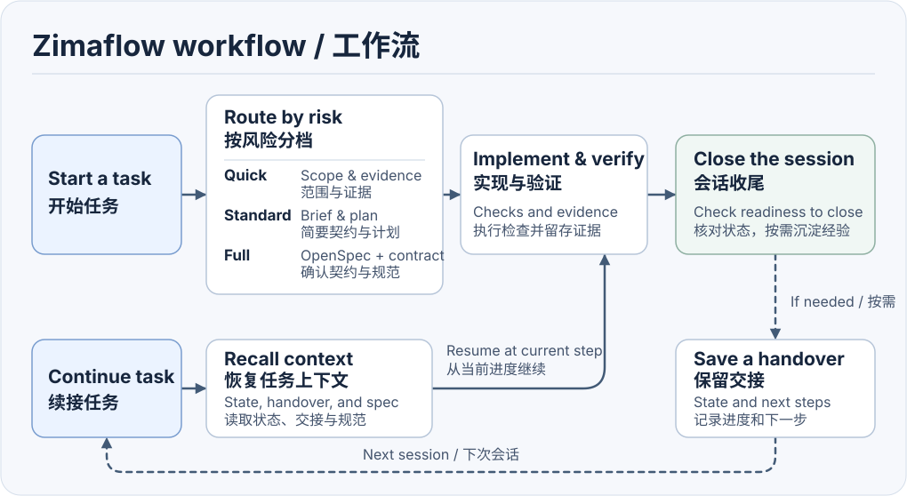

# Zimaflow

<p align="center">
  <a href="https://github.com/zima-explorer/zima-flow/releases"></a>
  <a href="https://github.com/zima-explorer/zima-flow/stargazers"></a>
  <a href="https://github.com/zima-explorer/zima-flow/network/members"></a>
  <a href="LICENSE"></a>
</p>

[English](README.md) | [简体中文](README.zh-CN.md)

## 为什么使用 Zimaflow

AI Coding 让实现变快，但需求边界、关键决策、验证结果和上下文也更容易散落在对话、分支与人的记忆里。Zimaflow 是把这些环节重新接稳的工作流层：让一次需求能够执行、复核，也能在中断后继续。

它为个人开发者和小团队带来三项直接收益：

- **减少不必要的返工**：在开始实现前，先对齐目标、范围和验收标准。
- **可复核的证据**：把任务与规范连接到实现检查，而不是把一段对话当成“已完成”的证明。
- **跨 session 续接**：在 handover 中保留当前状态、未决问题和下一步，不必让新的 session 从头猜测。

Zimaflow 不是 AI 编程 agent，不是项目管理系统，也不是个人工作区的镜像。它与 Claude Code、Codex 和 WorkBuddy 配合，为已有的编码能力补上一条可靠的工程流程。

## 1.22.12 有什么更新

Zimaflow 1.22.12 明确审核者与执行者之间的协作规则：

- 同一 objective 第三轮正式审核及以后仍未通过时，审核者先复盘范围、设计和验收条件，再进入下一轮返修；测试重跑和 checkpoint 不计审核轮次。
- 七项决策请求放进现有六区块执行报告，说明依据、选项、推荐、影响及决定后的动作，并保留验证命令和证据引用。
- 已有效覆盖当前动作的授权可跨返修轮次沿用；真实阻断仍通过既有绑定批准与 resume 协议恢复。
- 本次是流程指引更新，不增加 CLI 行为、状态字段、调度服务或发布权限。

此前版本的 Golden-case Eval、原型评审与人工最终验收，以及高风险改动的人类接手者检查继续保留。

## 工作流如何运转

路由需求 → 确认轻量契约 → 拆解 first slice → 有纪律地实现 → 验证结果 → 交接、收口并沉淀可复用经验。

Zimaflow 会先按改动规模选择合适的流程档位：

- **Quick：**低风险、聚焦的小改动；确认目标、范围和完成证据即可，不额外制造流程产物。
- **Standard：**范围可控的功能或扩展；先对齐短 brief，拆解工作，并验证关键路径。
- **Full：**跨模块或高风险改动；通过已确认的契约和 OpenSpec，让决策、交付和审核均可追溯。

复杂改动时，Zimaflow 协调 OpenSpec 承接规范与实现工作流；小改动时，则在不引入重流程的前提下守住范围和证据。



## 保持轻量

多数需求从 brief 开始，而不是完整 spec。只有改动足够复杂或风险足够高时，Zimaflow 才提升流程等级。它把重要判断变得可见、可供人复核，但不会把每个任务都变成合规仪式。

## 快速开始

先安装你所使用宿主的 CLI。本仓库包含 Zimaflow 1.22.12。

Claude Code：

```sh
claude plugin marketplace add zima-explorer/zima-flow
claude plugin install zimaflow@zimaflow
```

Codex：

```sh
codex plugin marketplace add zima-explorer/zima-flow
codex plugin add zimaflow@zimaflow
```

## 受限网络

上面的 owner/repository 命令通过 GitHub HTTPS 获取仓库。若 HTTPS 受限，可通过 SSH clone 后，从父目录注册本地 checkout：

```sh
git clone git@github.com:zima-explorer/zima-flow.git
claude plugin marketplace add ./zima-flow
codex plugin marketplace add ./zima-flow
```

## 验证安装

```sh
claude plugin list
codex plugin list
```

WorkBuddy 使用已初始化的 Zimaflow 项目。项目至少应包含 `.zimaflow/project.yaml` 与 `openspec/config.yaml`：

```sh
ZIMAFLOW_ROOT=/absolute/path/to/zima-flow
PROJECT_ROOT=/absolute/path/to/your-project

"$ZIMAFLOW_ROOT/runtime/zimaflow/bin/zimaflow" --version
"$ZIMAFLOW_ROOT/runtime/zimaflow/bin/zimaflow" doctor workbuddy \
  --project "$PROJECT_ROOT" \
  --runtime-manifest "$ZIMAFLOW_ROOT/adapters/workbuddy/runtime-manifest.yaml"
```

## WorkBuddy

WorkBuddy 通过 `adapters/workbuddy/runtime-manifest.yaml` 使用 `runtime/zimaflow` 中的可移植运行时，不需要单独的 marketplace 入口。

## 更新或移除

```sh
claude plugin update zimaflow@zimaflow
claude plugin uninstall zimaflow@zimaflow
claude plugin marketplace remove zimaflow

codex plugin marketplace upgrade zimaflow
codex plugin remove zimaflow@zimaflow
codex plugin add zimaflow@zimaflow

# 或者彻底移除安装和 marketplace。
codex plugin remove zimaflow@zimaflow
codex plugin marketplace remove zimaflow
```

## 验证发行内容

release manifest 用于验证不可变发行 payload。请 checkout 要验证的 tag，避免使用包含后续本地改动的 working copy。本版本执行：

```sh
git clone https://github.com/zima-explorer/zima-flow.git
cd zima-flow
git checkout v1.22.12
./verify-release.sh --distribution .
```

verifier 会检查版本、manifest 结构、artifact hash 与已记录 payload 是否发生漂移。

## 包含内容

- Claude Code plugin：`plugins/claude`
- Codex plugin：`plugins/codex`
- WorkBuddy adapter：`adapters/workbuddy`
- 共享 runtime：`runtime/zimaflow`

## 完整性与信任边界

`release-manifest.yaml` 记录了 artifact 与 payload 的预期 hash。verifier 会重新计算它们，用于发现 checkout 与已记录发行内容之间的漂移。

manifest 没有签名，因此这项检查不能证明发布者身份，也不构成密码学真实性证明。

## 许可证

Zimaflow 使用 MIT License。参见 [LICENSE](LICENSE) 与 [THIRD_PARTY_NOTICES](THIRD_PARTY_NOTICES)。
